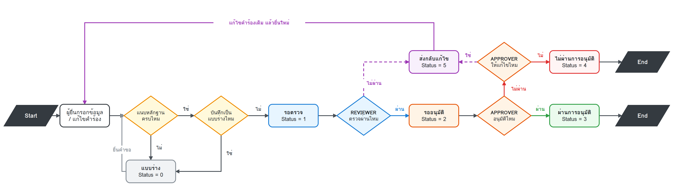
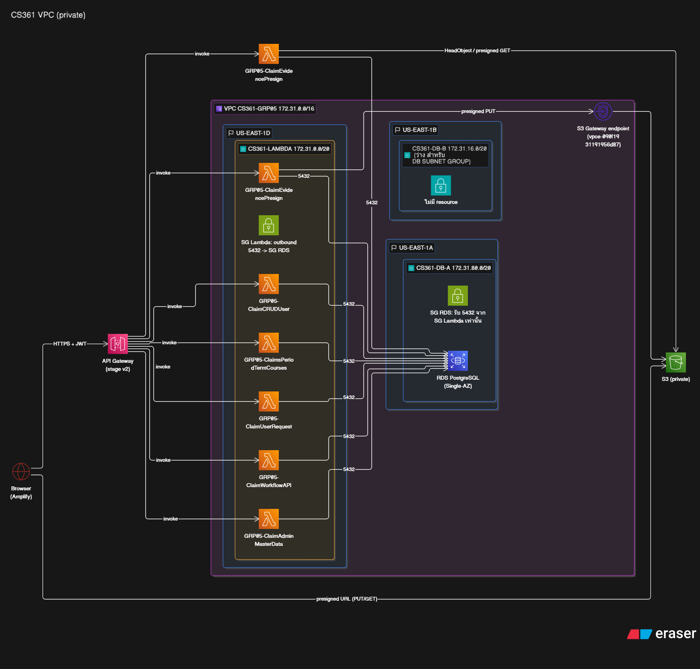
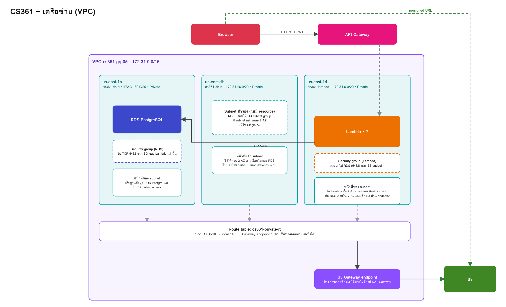
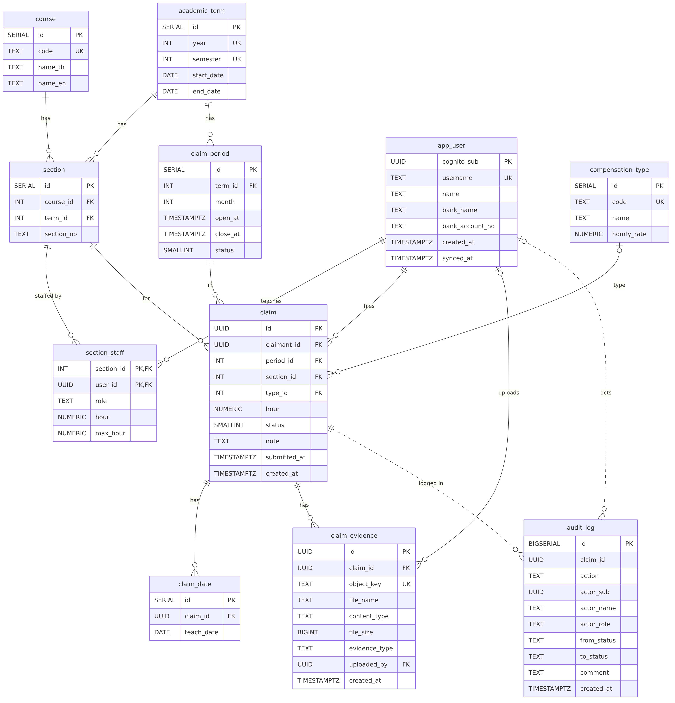

# CS361_G650-05 : ระบบจัดการการเบิกค่าตอบแทนการสอน

ระบบกลางสำหรับยื่น ตรวจสอบ อนุมัติ และติดตามสถานะการเบิกค่าตอบแทนการสอนของอาจารย์และผู้ช่วยสอน (TA)

## สารบัญ

1. [ภาพรวมโครงการ](#1-ภาพรวมโครงการ)
2. [ขั้นตอนการใช้งาน (User Flow)](#2-ขั้นตอนการใช้งาน-user-flow)
3. [สถาปัตยกรรมระบบ (Architecture)](#3-สถาปัตยกรรมระบบ-architecture)
4. [ฐานข้อมูล (Database)](#4-ฐานข้อมูล-database)
5. [สิทธิ์การใช้งานและการเป็นเจ้าของข้อมูล](#5-สิทธิ์การใช้งานและการเป็นเจ้าของข้อมูล)
6. [API และ Lambda](#6-api-และ-lambda)
7. [โครงสร้างโฟลเดอร์ใน GitHub](#7-โครงสร้างโฟลเดอร์ใน-github)

---

## 1. ภาพรวมโครงการ

### วิสัยทัศน์ (Project Vision)

ออกแบบระบบกลางสำหรับจัดการการเบิกค่าตอบแทนการสอนและค่าตอบแทนที่เกี่ยวข้อง ซึ่งสามารถติดตามสถานะ ตรวจสอบประวัติ และสรุปข้อมูลเพื่อการบริหารจัดการได้

### ผู้ใช้งานเป้าหมาย (Primary User)

อาจารย์/ผู้สอน และผู้ช่วยสอน (TA) ที่ต้องการยื่นขอเบิกค่าตอบแทน และติดตามสถานะของคำขอ

### ปัญหาที่พบ (Problem)

การขอเบิกค่าการสอนต้องใช้ข้อมูลที่กระจายอยู่ในแบบฟอร์ม เอกสาร หรือไฟล์หลายชุด ทำให้ผู้ขอเบิกต้องกรอกข้อมูลซ้ำและติดตามสถานะคำร้องได้ยาก ส่วนเจ้าหน้าที่ใช้เวลามากเพราะต้องผ่านกระบวนการเซ็นเอกสาร ทำให้ติดตามสถานะหรือดูภาพรวมได้ยาก ไม่เป็นระบบ

### ระบบภายนอก / แหล่งข้อมูล

- ข้อมูลตารางสอน
- ข้อมูลรายวิชา
- ข้อมูลอาจารย์และ TA
- ข้อมูลการเบิกจ่ายค่าตอบแทน
- ระบบบัญชี/การเงินของมหาวิทยาลัย

## 2. ขั้นตอนการใช้งาน (User Flow)



### สถานะของคำขอ

| รหัส | สถานะ | ความหมาย |
|---|---|---|
| 0 | ร่าง | ผู้ยื่นบันทึกไว้ ยังไม่ส่ง |
| 1 | รอตรวจ | ผู้ยื่นส่งแล้ว รอเจ้าหน้าที่ตรวจสอบ |
| 2 | รออนุมัติ | เจ้าหน้าที่ตรวจผ่านแล้ว รอผู้อนุมัติ |
| 3 | อนุมัติ | ผู้อนุมัติอนุมัติแล้ว |
| 4 | ไม่อนุมัติ | ผู้อนุมัติปฏิเสธ |
| 5 | ส่งคืนแก้ไข | ถูกส่งกลับให้ผู้ยื่นแก้ไขแล้วส่งใหม่ |
| 6 | จ่ายเงินแล้ว | ระบบเปลี่ยนจากสถานะ 3 ให้อัตโนมัติหลังอนุมัติ (บันทึกเวลาที่ `claim.paid_at`) |

### โควตาชั่วโมงต่อคนต่อ section

- ผู้สอนแต่ละคนใน section มีโควตา `max_hour` ที่ตาราง `section_staff` (ตั้งโดย ADMIN)
- `section_staff.hour` คือชั่วโมงที่คนนั้นเบิกไปแล้ว นับจากคำขอสถานะ 1, 2, 3
- ยื่นหรือส่งใหม่จะจองชั่วโมงทันที ถ้าเกิน `max_hour` ระบบปฏิเสธ
- เมื่อคำขอถูกไม่อนุมัติ (4) หรือส่งคืนแก้ไข (5) ผ่าน `ClaimWorkflowAPI` ระบบคืนชั่วโมงให้

## 3. สถาปัตยกรรมระบบ (Architecture)



ไฟล์ต้นฉบับแก้ไขได้ด้วย draw.io: [CS361_V4.drawio](docs/AWS_Architecture/CS361_V4.drawio)

รายละเอียดแต่ละ service: [docs/AWS_Architecture/AWS_Architecture.md](docs/AWS_Architecture/AWS_Architecture.md)

| ส่วน | เทคโนโลยี | หน้าที่ |
|---|---|---|
| Frontend | React + Vite บน AWS Amplify | หน้าเว็บของผู้ใช้ทุกบทบาท |
| Authentication | Amazon Cognito | ล็อกอินและกำหนดกลุ่มผู้ใช้ (TEACHER, TA, REVIEWER, APPROVER, ADMIN) |
| API | API Gateway (REST) stage `v2` | จุดรับคำขอจากหน้าเว็บ ตรวจ token ด้วย Cognito authorizer |
| Backend | AWS Lambda (Node.js 22, ESM) ใน VPC | ตรรกะยื่นคำขอ ตรวจ อนุมัติ จัดการหลักฐาน และงานของผู้ดูแล |
| Database | RDS PostgreSQL | เก็บคำขอ รายวิชา รอบการยื่น ประวัติ |
| File storage | S3 (private bucket) | เก็บไฟล์หลักฐาน เข้าถึงผ่าน presigned URL อายุสั้น |

### เครือข่าย (VPC)



ต้นฉบับ draw.io: [VPC.drawio](docs/AWS_Architecture/VPC.drawio) · รายละเอียด subnet / route table / security group: [docs/AWS_Architecture/VPC.md](docs/AWS_Architecture/VPC.md)

- Lambda และ RDS อยู่ใน VPC เดียวกัน การเชื่อมต่อฐานข้อมูลคุมด้วย security group (RDS รับพอร์ต 5432 จาก security group ของ Lambda)
- Lambda เรียก S3 ผ่าน **S3 Gateway endpoint** (ไม่มีค่าใช้จ่าย) ไม่ต้องมี NAT Gateway
- โค้ด Lambda เรียกเฉพาะ RDS และ S3 จึงไม่ต้องออกอินเทอร์เน็ต
- การตรวจสิทธิ์ใช้ Cognito authorizer ที่ API Gateway และอ่านกลุ่มจาก `cognito:groups` ใน token

## 4. ฐานข้อมูล (Database)



- ผู้ใช้ใน Cognito เป็นแหล่งข้อมูลหลัก ส่วนตาราง `app_user` เป็นเพียงสำเนาบางส่วน โดยใช้ `cognito_sub` เป็นคีย์
- ตารางหลัก: `app_user`, `academic_term`, `course`, `section`, `section_staff`, `claim_period`, `compensation_type`, `claim`, `claim_date`, `claim_evidence`, `audit_log` และ view `claim_amount`
- ยอดเงินคำนวณจาก `claim.hour × compensation_type.hourly_rate` (view `claim_amount`)

### Migration (`docs/database/migrations/`)

**Automated Migration & Seeding (V5)**

ระบบใช้ Migration Runner สำหรับติดตามและ Execute
Database Migrations โดยอัตโนมัติ

รองรับ Migration History, Checksum Validation,
Transaction Rollback, Status Inspection และ Legacy Baseline

คู่มือการใช้งานและข้อควรระวัง:
[Database Migration Guide](docs/database/MIGRATION_GUIDE.md)

| ไฟล์ | ทำอะไร |
|---|---|
| `001_schema.sql` | สร้างตาราง ดัชนี และ view ทั้งหมดในครั้งเดียว (รวมผลของ migration เดิม 001–017) |
| `002_seed.sql` | ข้อมูลตัวอย่าง: ผู้ใช้ placeholder, ภาคการศึกษา, รายวิชา, section, `section_staff` (พร้อม `max_hour`), รอบเบิก, ประเภทค่าตอบแทน 2 แบบ |
| `003_claim_paid_status.sql` | เพิ่มสถานะคำขอ 6 = จ่ายเงินแล้ว (ปรับ `claim_status_check`) |
| `004_add_claim_paid_at.sql` | เพิ่มคอลัมน์ `claim.paid_at` เก็บเวลาที่จ่ายเงิน |
| `_archive/` | migration เดิม 001–017 เก็บไว้อ้างอิงประวัติ ไม่ต้องรันอีก |

วิธีใช้:

| กรณี | สิ่งที่ต้องรัน (ตามลำดับ) |
|---|---|
| ฐานข้อมูลใหม่ (ว่าง) | `001_schema.sql` → `002_seed.sql` → `003_claim_paid_status.sql` → `004_add_claim_paid_at.sql` |
| RDS ที่รัน migration เดิมถึง 017 แล้ว | `003_claim_paid_status.sql` → `004_add_claim_paid_at.sql` (ไม่ต้องรัน 001/002 ซ้ำ) |

```bash
psql "$DATABASE_URL" -f docs/database/migrations/001_schema.sql
```

เมื่อ RDS อยู่ใน private subnet ต้องรันจากที่เข้าถึง VPC ได้ (เช่น CloudShell แบบ VPC)

เมื่อเพิ่ม migration ใหม่ ให้ตั้งเลขไฟล์ต่อจากล่าสุด และตรวจว่าเลขไม่ซ้ำกับของคนอื่นในทีมก่อน push

## 5. สิทธิ์การใช้งานและการเป็นเจ้าของข้อมูล

**อาจารย์ / TA**

- เข้าถึงบัญชีของตัวเองได้
- ยื่น แก้ไข และลบคำขอของตัวเองได้เท่านั้น
- แนบหลักฐานประกอบ (`supporting`) และเอกสารลงนาม (`signed_form`) กับคำขอของตัวเองได้ตามสถานะที่กำหนด (สิทธิ์แนบดูที่ `UPLOAD_RULES` ใน `ClaimEvidenceAPI` และ `ClaimEvidencePresign`)
- ดูคำขอหรือข้อมูลของคนอื่นไม่ได้
- ยืนยันการตรวจสอบหรืออนุมัติคำขอไม่ได้

**เจ้าหน้าที่ / ผู้ตรวจสอบ (REVIEWER)**

- เข้าถึงคำขอทั้งหมดได้ แต่แก้ไขหรือลบไม่ได้
- ยืนยันตรวจสอบหรือส่งคืนคำขอได้
- แนบเอกสารลงนาม (`signed_form`) กับคำขอที่ยื่นแล้ว (สถานะ 1, 2, 3) ได้ และดูไฟล์แนบของคำขอที่ไม่ใช่ร่างได้
- อนุมัติหรือปฏิเสธคำขอไม่ได้

**ผู้บริหาร / ผู้อนุมัติ (APPROVER)**

- เข้าถึงคำขอทั้งหมดได้ แต่แก้ไขหรือลบไม่ได้
- อนุมัติ ปฏิเสธ หรือส่งคืนคำขอได้
- ยืนยันตรวจสอบไม่ได้

**ผู้ดูแลระบบ (ADMIN)**

- ดูคำขอทั้งหมดและภาพรวมระบบได้ (อ่านอย่างเดียว) แก้ไขหรือลบคำขอไม่ได้
- ดูประวัติการดำเนินการทั้งระบบและส่งออกรายงาน (CSV) ได้
- จัดการข้อมูลพื้นฐาน: เพิ่ม/ลบ section และกำหนดผู้สอนพร้อมโควตาชั่วโมง (`/api/admin/*`)
- ยืนยันตรวจสอบ อนุมัติ ปฏิเสธ หรือส่งคืนคำขอไม่ได้
- เปิดดูเอกสารแนบและข้อมูลส่วนบุคคลของผู้ยื่นไม่ได้

## 6. API และ Lambda

REST API ชื่อ `cs361-claims-api` (stage `v2`) ทุก method ใช้ Cognito authorizer และ Lambda proxy integration ชื่อ Lambda ใน AWS ขึ้นต้นด้วย `GRP05-` เช่น `GRP05-ClaimWorkflowAPI`

| Route | Lambda | หน้าที่ |
|---|---|---|
| `POST /api/auth/me` | `ClaimCRUDUser` | สร้าง/อัปเดตผู้ใช้ใน `app_user` หลัง login และคืนกลุ่ม |
| `GET /api/term`, `/api/period`, `/api/courses`, `/api/compensation-types` | `ClaimsPeriodTermCourses` | ข้อมูลอ้างอิงสำหรับฟอร์มยื่น (รองรับแบ่งหน้า `limit`/`offset`) |
| `GET/POST/DELETE /api/claims`, `POST /api/claims/{id}/resend` | `ClaimUserRequest` | สร้าง ดู ลบ ส่งใหม่ และคิวตรวจ/รายงาน (`?scope=review\|report`) |
| `POST /api/claims/{id}/actions`, `POST /api/claims/batch-actions`, `GET /api/claims/{id}/history`, `GET /api/audit-logs` | `ClaimWorkflowAPI` | ตรวจ/อนุมัติ/ปฏิเสธ/ส่งคืน (`action`: `REVIEW_PASS`, `APPROVE`, `REJECT`, `RETURN`), จ่ายเงินอัตโนมัติ, ประวัติ, audit log |
| `POST /api/claims/{id}/evidence/upload-url` | `ClaimEvidencePresign` | ออกลิงก์ presigned PUT สำหรับอัปโหลดไฟล์ไป S3 |
| `POST/GET /api/claims/{id}/evidence` | `ClaimEvidenceAPI` | ลงทะเบียนไฟล์ที่อัปโหลดแล้ว และออกลิงก์เปิดไฟล์ (presigned GET) |
| `ANY /api/admin/{proxy+}` | `ClaimAdminMasterData` | ADMIN: เพิ่ม/ลบ section, จัดการผู้สอน (`section_staff`), รายชื่อผู้ใช้ |

รายละเอียด request/response: [docs/api/](docs/api/) และ [script/lambda/functions/README.md](script/lambda/functions/README.md)

### ขั้นตอนอัปโหลดหลักฐาน

1. หน้าเว็บเรียก `POST /api/claims/{id}/evidence/upload-url` ได้ `uploadUrl` และ `objectKey` (`{sub เจ้าของคำขอ}/{claim_id}/{evidence_id}.{ext}`)
2. หน้าเว็บ `PUT` ไฟล์ขึ้น S3 ตรงด้วย `uploadUrl` (ต้องส่ง `Content-Type` ตรงกับที่ขอ)
3. หน้าเว็บเรียก `POST /api/claims/{id}/evidence` เพื่อลงทะเบียน (Lambda ตรวจขนาด/ชนิดไฟล์ด้วย `HeadObject`)
4. ดูไฟล์ด้วย `GET /api/claims/{id}/evidence` ได้ลิงก์ที่หมดอายุภายในไม่กี่นาที

## 7. โครงสร้างโฟลเดอร์ใน GitHub

```
cs-361_G650-05/
├── README.md
├── .github/
│   └── workflows/
│       └── frontend-deploy.yml
├── infra/
│   ├── README.md
│   ├── network.yaml
│   ├── backend.yaml
│   └── deploy_script/
│       ├── build.sh
│       ├── deploy.sh
│       ├── destroy.sh
│       └── migrate/
│           └── index.mjs
├── backend/
│   └── lambda/
│       └── functions/
│           ├── ClaimCRUDUser/
│           ├── ClaimsPeriodTermCourses/
│           ├── ClaimUserRequest/
│           ├── ClaimWorkflowAPI/
│           ├── ClaimEvidenceAPI/
│           ├── ClaimEvidencePresign/
│           └── ClaimAdminMasterData/
├── docs/
│   ├── api/
│   ├── AWS_Architecture/
│   ├── DataFlow/
│   └── database/
│       └── migrations/
│           └── _archive/
└── teaching-claim-system/
    ├── public/
    └── src/
        ├── components/
        ├── data/
        ├── hooks/
        ├── pages/
        ├── services/
        └── utils/
```

### เอกสาร (`docs/`)

| Path | หมายถึง |
|---|---|
| `docs/api/` | `README.md` (ภาพรวม, สถานะ, error) และ `endpoints.md` (request/response แต่ละ endpoint) |
| `docs/AWS_Architecture/` | `AWS_Architecture.md` (อธิบายแต่ละ service) และ `CS361_V4.png` (ภาพ architecture), `VPC.md` / `VPC.png` (เครือข่าย) พร้อมไฟล์ `.drawio` |
| `docs/DataFlow/` | แผนภาพขั้นตอนการใช้งาน `claim_user_flow.png` / `.svg` |
| `docs/database/` | ภาพ ER diagram `V4_Databaseschema.png` และต้นฉบับ Mermaid `Databaseschema.mmd` |
| `docs/database/migrations/` | SQL สร้างและแก้ฐานข้อมูล (ดูหัวข้อ 4) |

### Infrastructure as Code (`infra/`)

สร้าง backend ทั้งระบบด้วย CloudFormation และสคริปต์ bash (วิธีใช้ดู [infra/README.md](infra/README.md))

| Path | หมายถึง |
|---|---|
| `infra/README.md` | วิธี deploy / ปรับปรุง / ลบ ตัวแปรที่ตั้งได้ และการแก้ปัญหาเบื้องต้น |
| `infra/network.yaml` | VPC, subnet, route table, S3 Gateway endpoint, Security Group, RDS PostgreSQL และ S3 bucket หลักฐาน |
| `infra/backend.yaml` | Cognito (User Pool, client, กลุ่มผู้ใช้), Lambda 7 ตัว + Lambda รัน migration และ API Gateway (SAM) |
| `infra/deploy_script/build.sh` | เตรียมโค้ด Lambda ลงโฟลเดอร์ `build/` พร้อมติดตั้ง `node_modules` |
| `infra/deploy_script/deploy.sh` | สร้างทั้งระบบ: network, backend, migration, ผู้ใช้ทดสอบใน Cognito แล้วพิมพ์ค่า `VITE_*` |
| `infra/deploy_script/destroy.sh` | ลบทั้งระบบ (ข้อมูลใน RDS และไฟล์หลักฐานหายถาวร) |
| `infra/deploy_script/migrate/index.mjs` | Lambda ชั่วคราวที่รัน SQL ใน `docs/database/migrations/` บน RDS |
| `build/` | สร้างตอนรันสคริปต์ ไม่ commit |

### Backend (`backend/`)

| Path | หมายถึง |
|---|---|
| `backend/lambda/functions/` | โค้ดของ Lambda แต่ละตัว (1 โฟลเดอร์ = 1 function, ชื่อโฟลเดอร์ใช้อ้างใน `CodeUri` ของ `infra/backend.yaml`) |

### CI/CD (`.github/`)

| Path | หมายถึง |
|---|---|
| `.github/workflows/frontend-deploy.yml` | build และ deploy frontend อัตโนมัติเมื่อมี push |

### Frontend (`teaching-claim-system/`)

| Path | หมายถึง |
|---|---|
| `teaching-claim-system/` | โปรเจกต์ React (Vite + Tailwind CSS) ที่ deploy บน Amplify |
| `teaching-claim-system/package.json` | รายการ dependency และคำสั่งรัน/build |
| `teaching-claim-system/vite.config.js`, `tailwind.config.js`, `postcss.config.js` | ไฟล์ตั้งค่า Vite, Tailwind, PostCSS |
| `teaching-claim-system/src/main.jsx`, `App.jsx` | จุดเริ่มแอปและการสลับหน้า |
| `teaching-claim-system/src/aws-config.js` | ตั้งค่า Cognito (Amplify) จาก `VITE_COGNITO_*` |
| `teaching-claim-system/src/pages/` | หน้าจอ เช่น `Dashboard`, `MyClaims`, `CreateClaim`, `ClaimDetail`, `ReviewQueue`, `Report`, `AuditLog`, `AdminManagement`, `AdminOverview` |
| `teaching-claim-system/src/components/` | ส่วนประกอบที่ใช้ซ้ำ เช่น `Sidebar`, `Topbar`, `StatusPill`, `WorkflowStepper`, `ReviewActionPanel`, `Pagination` |
| `teaching-claim-system/src/data/` | ค่าคงที่และตรรกะฝั่งหน้าเว็บ เช่น `workflow.js` (สถานะ), `roles.js` (บทบาท), `rates.js` (อัตรา) และข้อมูลจำลอง |
| `teaching-claim-system/src/services/` | โค้ดเรียก API และ auth: `api.js`, `auth.js`, `evidence.js` (อัปโหลดหลักฐาน), `claimMapper.js` (แปลงข้อมูลจาก API) |
| `teaching-claim-system/src/hooks/`, `utils/` | React hooks และฟังก์ชันช่วย เช่น `csv.js`, `time.js`, `sla.js` |
