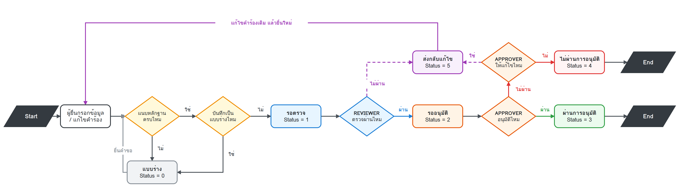
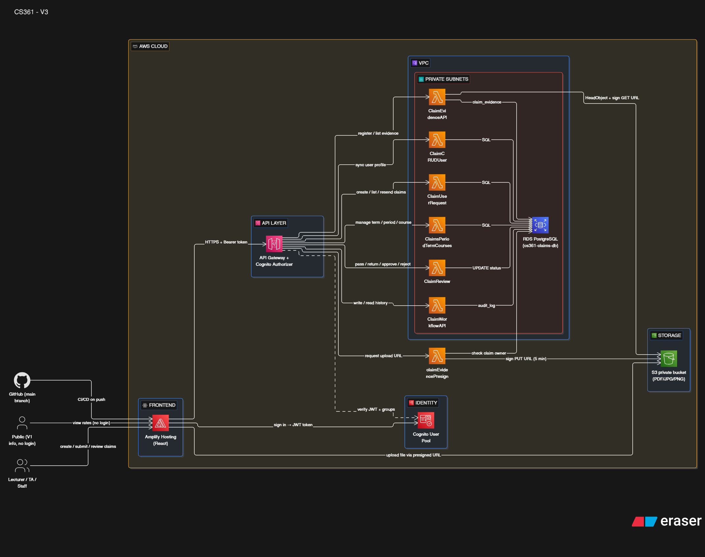
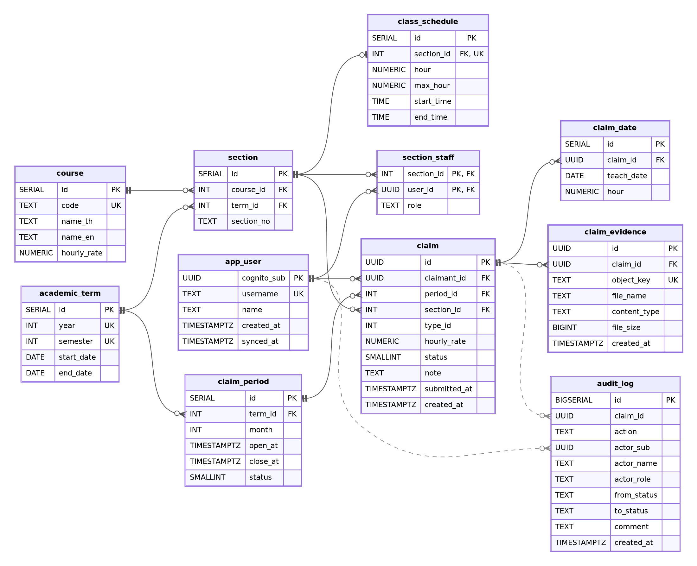

# CS361_G650-05 : ระบบจัดการการเบิกค่าตอบแทนการสอน

ระบบกลางสำหรับยื่น ตรวจสอบ อนุมัติ และติดตามสถานะการเบิกค่าตอบแทนการสอนของอาจารย์และผู้ช่วยสอน (TA)

## สารบัญ

1. [ภาพรวมโครงการ](#1-ภาพรวมโครงการ)
2. [ขั้นตอนการใช้งาน (User Flow)](#2-ขั้นตอนการใช้งาน-user-flow)
3. [สถาปัตยกรรมระบบ (Architecture)](#3-สถาปัตยกรรมระบบ-architecture)
4. [ฐานข้อมูล (Database)](#4-ฐานข้อมูล-database)
5. [สิทธิ์การใช้งานและการเป็นเจ้าของข้อมูล](#5-สิทธิ์การใช้งานและการเป็นเจ้าของข้อมูล)
6. [โครงสร้างโฟลเดอร์ใน GitHub](#6-โครงสร้างโฟลเดอร์ใน-github)
7. [วิธีรันฝั่ง Frontend](#7-วิธีรันฝั่ง-frontend)

---

## 1. ภาพรวมโครงการ

### วิสัยทัศน์ (Project Vision)

ออกแบบระบบกลางสำหรับจัดการการเบิกค่าตอบแทนการสอนและค่าตอบแทนที่เกี่ยวข้อง ซึ่งสามารถติดตามสถานะ ตรวจสอบประวัติ และสรุปข้อมูลเพื่อการบริหารจัดการได้

### ผู้ใช้งานเป้าหมาย (Primary User)

อาจารย์/ผู้สอน และผู้ช่วยสอน (TA) ที่ต้องการยื่นขอเบิกค่าตอบแทน และติดตามสถานะของคำขอ

### ปัญหาที่พบ (Problem)

การขอเบิกค่าการสอนต้องใช้ข้อมูลที่กระจายอยู่ในแบบฟอร์ม เอกสาร หรือไฟล์หลายชุด ทำให้ผู้ขอเบิกต้องกรอกข้อมูลซ้ำและติดตามสถานะคำร้องได้ยาก ส่วนเจ้าหน้าที่ใช้เวลามากเพราะต้องผ่านกระบวนการเซ็นเอกสาร ทำให้ติดตามสถานะหรือดูภาพรวมได้ยาก ไม่เป็นระบบ

### ระบบภายนอก / แหล่งข้อมูล

- ข้อมูลตารางสอน
- ข้อมูลรายวิชา
- ข้อมูลอาจารย์และ TA
- ข้อมูลการเบิกจ่ายค่าตอบแทน
- ระบบบัญชี/การเงินของมหาวิทยาลัย

## 2. ขั้นตอนการใช้งาน (User Flow)



### สถานะของคำขอ

| รหัส | สถานะ | ความหมาย |
|---|---|---|
| 0 | ร่าง | ผู้ยื่นบันทึกไว้ ยังไม่ส่ง |
| 1 | รอตรวจ | ผู้ยื่นส่งแล้ว รอเจ้าหน้าที่ตรวจสอบ |
| 2 | รออนุมัติ | เจ้าหน้าที่ตรวจผ่านแล้ว รอผู้อนุมัติ |
| 3 | อนุมัติ | ผู้อนุมัติอนุมัติแล้ว |
| 4 | ไม่อนุมัติ | ผู้อนุมัติปฏิเสธ |
| 5 | ส่งคืนแก้ไข | ถูกส่งกลับให้ผู้ยื่นแก้ไขแล้วส่งใหม่ |

## 3. สถาปัตยกรรมระบบ (Architecture)



รายละเอียดแต่ละ service: [docs/AWS_Architecture/AWS_Architecture.md](docs/AWS_Architecture/AWS_Architecture.md)

| ส่วน | เทคโนโลยี | หน้าที่ |
|---|---|---|
| Frontend | React + Vite บน AWS Amplify | หน้าเว็บของผู้ใช้ทุกบทบาท |
| Authentication | Amazon Cognito | ล็อกอินและกำหนดกลุ่มผู้ใช้ (TEACHER, TA, REVIEWER, APPROVER) |
| API | API Gateway (REST) | จุดรับคำขอจากหน้าเว็บ ตรวจ token ก่อนส่งต่อ |
| Backend | AWS Lambda (Node.js 22) ใน VPC | ตรรกะยื่นคำขอ ตรวจ อนุมัติ และออกลิงก์ไฟล์ |
| Database | RDS PostgreSQL | เก็บคำขอ รายวิชา รอบการยื่น ประวัติ |
| File storage | S3 (private bucket) | เก็บไฟล์หลักฐาน เข้าถึงผ่าน presigned URL อายุสั้น |

## 4. ฐานข้อมูล (Database)



- สคริปต์สร้างและแก้โครงสร้างฐานข้อมูลอยู่ใน [docs/database/migrations/](docs/database/migrations/) รันตามลำดับเลขไฟล์
- ผู้ใช้ใน Cognito เป็นแหล่งข้อมูลหลัก ส่วนตาราง `app_user` เป็นเพียงสำเนาบางส่วน โดยใช้ `cognito_sub` เป็นคีย์

## 5. สิทธิ์การใช้งานและการเป็นเจ้าของข้อมูล

**อาจารย์ / TA**

- เข้าถึงบัญชีของตัวเองได้
- ยื่น แก้ไข และลบคำขอของตัวเองได้เท่านั้น
- ดูคำขอหรือข้อมูลของคนอื่นไม่ได้
- ยืนยันการตรวจสอบหรืออนุมัติคำขอไม่ได้

**เจ้าหน้าที่ / ผู้ตรวจสอบ (REVIEWER)**

- เข้าถึงคำขอทั้งหมดได้ แต่แก้ไขหรือลบไม่ได้
- ยืนยันตรวจสอบหรือส่งคืนคำขอได้
- อนุมัติหรือปฏิเสธคำขอไม่ได้

**ผู้บริหาร / ผู้อนุมัติ (APPROVER)**

- เข้าถึงคำขอทั้งหมดได้ แต่แก้ไขหรือลบไม่ได้
- อนุมัติ ปฏิเสธ หรือส่งคืนคำขอได้
- ยืนยันตรวจสอบไม่ได้

## 6. โครงสร้างโฟลเดอร์ใน GitHub

```
cs-361_G650-05/
├── README.md
├── package-lock.json
├── docs/
│   ├── AWS_Architecture/
│   ├── DataFlow/
│   ├── database/
│   │   └── migrations/
│   └── testing/
└── teaching-claim-system/
    ├── public/
    └── src/
        ├── components/
        ├── data/
        ├── hooks/
        ├── pages/
        ├── services/
        └── utils/
```

### เอกสาร (`docs/`)

| Path | หมายถึง |
|---|---|
| `docs/AWS_Architecture/` | เอกสารสถาปัตยกรรม: `AWS_Architecture.md` (อธิบายแต่ละ service) และ `CS361 - V3.png` (ภาพ architecture) |
| `docs/DataFlow/` | แผนภาพขั้นตอนการใช้งาน `claim_user_flow.png` / `.svg` |
| `docs/database/` | ภาพ ER diagram `V3_Databaseschema.png` |
| `docs/database/migrations/` | SQL สำหรับสร้างและแก้ฐานข้อมูล รันตามลำดับ (ตารางด้านล่าง) |
| `docs/testing/` | สคริปต์ทดสอบสิทธิ์และความปลอดภัย `rbac_security_test.sh` |

### Migration (`docs/database/migrations/`)

| ไฟล์ | ทำอะไร |
|---|---|
| `001_app_user.sql` | ตาราง `app_user` (สำเนาผู้ใช้จาก Cognito) |
| `002_claim_submission.sql` | ตารางหลักของการยื่นคำขอ: course, section, claim, ประเภทค่าตอบแทน ฯลฯ |
| `003_seed_users.sql` | ข้อมูลผู้ใช้ตัวอย่าง |
| `004_section_staff.sql` | ผู้สอน/TA ประจำ section |
| `005_seed_reference.sql` | ข้อมูลอ้างอิง เช่น รายวิชา ภาคการศึกษา |
| `006_claim_evidence.sql` | ตารางไฟล์หลักฐานของคำขอ |
| `007_claim_date.sql` | ตาราง `claim_date` (วันที่สอนของแต่ละคำขอ) |
| `008_seed_claim_period.sql` | รอบการยื่นรายเดือนเริ่มต้น |
| `009_monthly_claim_course_rate.sql` | ยื่นรายเดือนตามรายวิชา และอัตราค่าตอบแทน |
| `010_claim_review_status.sql` | เปลี่ยนสถานะเป็นชุด 0-5 สำหรับขั้นตรวจและอนุมัติ |
| `011_audit_log.sql` | ตาราง `audit_log` เก็บประวัติการตรวจและอนุมัติ |
| `012_claim_hour_section_merge.sql` | ย้ายชั่วโมงไปที่ `claim.hour`, ยื่นได้หลายครั้งต่อเดือน, รวม `class_schedule` เข้า `section` |

### Frontend (`teaching-claim-system/`)

| Path | หมายถึง |
|---|---|
| `teaching-claim-system/` | โปรเจกต์ React (Vite + Tailwind CSS) ที่ deploy บน Amplify |
| `teaching-claim-system/package.json` | รายการ dependency และคำสั่งรัน/build |
| `teaching-claim-system/vite.config.js`, `tailwind.config.js`, `postcss.config.js` | ไฟล์ตั้งค่า Vite, Tailwind, PostCSS |
| `teaching-claim-system/index.html` | HTML หลักของแอป |
| `teaching-claim-system/public/` | ไฟล์คงที่: รูปภาพ (`images/`, `banner1.png`, `grid.png`, `dot.png`) และเอกสาร (`documents/`) |
| `teaching-claim-system/src/main.jsx`, `App.jsx` | จุดเริ่มแอปและการสลับหน้า |
| `teaching-claim-system/src/aws-config.js` | ค่าตั้งค่าเชื่อมต่อ Cognito และ API |
| `teaching-claim-system/src/theme.js`, `index.css` | สีและสไตล์ร่วมของแอป |
| `teaching-claim-system/src/pages/` | หน้าจอ เช่น `Dashboard`, `MyClaims`, `CreateClaim`, `ClaimDetail`, `ReviewQueue`, `AuditLog`, `Login` |
| `teaching-claim-system/src/components/` | ส่วนประกอบที่ใช้ซ้ำ เช่น `Sidebar`, `Topbar`, `StatusPill`, `WorkflowStepper`, `ReviewActionPanel`, `Pagination` |
| `teaching-claim-system/src/data/` | ค่าคงที่และตรรกะฝั่งหน้าเว็บ เช่น `workflow.js` (สถานะ), `roles.js` (บทบาท), `rates.js` (อัตรา) และข้อมูลจำลอง |
| `teaching-claim-system/src/hooks/` | React hooks เช่น `useNotifications.js` |
| `teaching-claim-system/src/services/` | โค้ดเรียก API และ auth: `api.js`, `auth.js`, `evidence.js` (อัปโหลดหลักฐาน), `claimMapper.js` (แปลงข้อมูลจาก API) |
| `teaching-claim-system/src/utils/` | ฟังก์ชันช่วย เช่น `csv.js`, `time.js`, `sla.js` |

> โค้ด Lambda ไม่ได้อยู่ใน repo นี้ (อยู่ในโฟลเดอร์ `lambda/` แยกต่างหาก)

## 7. วิธีรันฝั่ง Frontend

```bash
cd teaching-claim-system
npm install
npm run dev
```

รายละเอียดโครงสร้างโค้ดเพิ่มเติม: [teaching-claim-system/README.md](teaching-claim-system/README.md)
