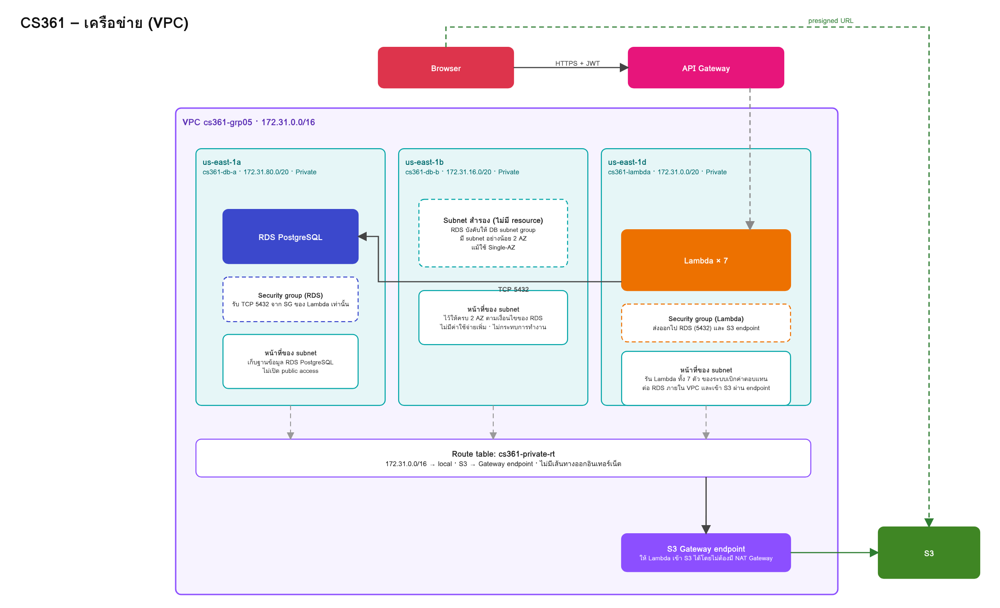

# เครือข่าย (VPC) ของ CS361

ต้นฉบับ draw.io: [VPC.drawio](./VPC.drawio) (ภาพ architecture รวม: [CS361_V4.png](./CS361_V4.png))

## ภาพรวม

- VPC `cs361-grp05` (`172.31.0.0/16`) region `us-east-1`
- Lambda และ RDS อยู่ใน private subnet ไม่มีเส้นทางออกอินเทอร์เน็ต
- API Gateway เรียก Lambda แบบ invoke (ไม่ผ่านเครือข่ายของ VPC) จากนั้น Lambda ต่อ RDS ภายใน VPC
- Lambda ทั้ง 7 ตัวอยู่ใน VPC เดียวกัน และใช้ Lambda layer `GRP05-node-deps`

## Subnet

| ชื่อ | AZ | CIDR | ใช้งาน |
|---|---|---|---|
| `cs361-lambda` | us-east-1d | `172.31.0.0/20` | Lambda ทั้ง 7 ตัว |
| `cs361-db-a` | us-east-1a | `172.31.80.0/20` | RDS PostgreSQL `cs361-claims-db` |
| `cs361-db-b` | us-east-1b | `172.31.16.0/20` | ว่าง ใช้เพื่อให้ DB subnet group ครบ 2 AZ ตามที่ RDS กำหนด |

## Route table

| Route table | Subnet | เส้นทาง |
|---|---|---|
| `cs361-private-rt` | ทั้ง 3 subnet | `172.31.0.0/16 → local` และ S3 prefix list `→` S3 Gateway endpoint (ไม่มีเส้นทางออกอินเทอร์เน็ต) |

## Security group

| SG | Inbound | หมายเหตุ |
|---|---|---|
| Lambda SG | ไม่มี | Outbound ไป RDS (5432) และ S3 endpoint |
| RDS SG | TCP 5432 จาก Lambda SG เท่านั้น | ไม่เปิด public access |

## S3 Gateway endpoint

endpoint ชนิด Gateway ของ `com.amazonaws.us-east-1.s3` ไม่มีค่าใช้จ่าย ให้ Lambda ที่จัดการหลักฐาน (`ClaimEvidenceAPI`, `ClaimEvidencePresign`) เข้าถึง S3 ได้โดยไม่ต้องมี NAT Gateway ต้องผูกกับ route table ที่ subnet ของ Lambda ใช้

## วิธีตรวจ

1. VPC console → เลือก `cs361-grp05` → แท็บ **Resource map** ดูว่าทั้ง 3 subnet ผูก `cs361-private-rt` และมี S3 endpoint
2. Route table `cs361-private-rt` ต้องไม่มี route `0.0.0.0/0`
3. ดู subnet ที่มี Lambda/RDS ใช้งาน: เมนู Network interfaces กรองตาม subnet
4. การรัน migration หรือ psql ต้องทำจากที่เข้าถึง VPC ได้ (เช่น CloudShell แบบ VPC environment)
